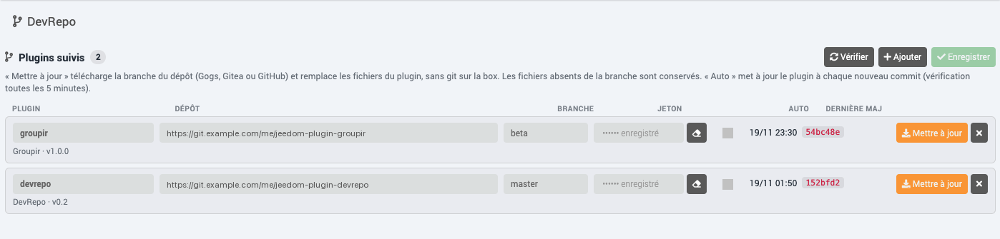

Description
===

DevRepo updates your **in-development** plugins directly from a branch of their Git repository (**Gogs**, **Gitea** or **GitHub**), without git or SSH access to the box. This is especially handy when Jeedom runs in a Docker container.

For each tracked plugin, a click on **Update** downloads the branch archive, checks that it really is the right plugin, replaces its files, then runs its update function (just like a regular update from the Market).

> For development only: files missing from the branch are not deleted, and no backup is made before the update.

Configuration
===

The list of tracked plugins is on the plugin page: **Plugins → Programming → DevRepo**. For each plugin:

- **Plugin**: its ID (name of its folder in `plugins/`), e.g. `groupir`. Installed plugins are suggested. A plugin that is not installed yet can be entered: DevRepo creates its folder, you then just have to enable it in the plugins management;
- **Repository**: repository URL, e.g. `https://server/owner/repository.git` or `https://github.com/owner/repository`;
- **Branch**: branch to follow (`beta` by default);
- **Auto**: automatically updates the plugin on each new commit on the branch (see below);
- **Token**: required if the repository is private (Gogs / Gitea: *Settings → Applications*; GitHub: *Settings → Developer settings → Personal access tokens*). It is stored **encrypted** and never displayed again: leave the field empty to keep it, or use the eraser to delete it.

Click **Save** (the list is also saved automatically before an update).

Usage
===

- **Check**: compares the last update of each plugin with the latest commit of its branch (*up to date* or *new commit*);
- **Update**: fetches the branch and replaces the plugin files. The *Last update* column shows the installed date and commit (details on hover).

Automatic update
===

For plugins whose **Auto** box is checked, DevRepo checks the branch **every 5 minutes**: as soon as a new commit is pushed, the plugin is updated just like with the *Update* button. A robot icon in *Last update* marks an update made automatically.

- The task is the **cron5** line of the *Functionalities* panel in the plugin configuration: disabling it suspends all automatic updates;
- if updating to a commit fails, it is not retried in a loop: DevRepo waits for the next commit (or a click on *Update*). The error is in the `devrepo` log;
- a temporarily unreachable repository is simply checked again on the next run.

Webhook: immediate update
===

Rather than waiting for the check, the repository can notify Jeedom on each push. The <i class="fas fa-plug"></i> button of a row shows the webhook URL for that plugin (Jeedom internal and external access):

- in the repository: *Settings → Webhooks* (Gogs, Gitea or GitHub), paste the URL, **push** event, **JSON** content type;
- the update only happens if **Auto** is checked and the pushed branch is the tracked one;
- the repository must be able to reach Jeedom: a Gogs / Gitea on the local network uses the internal access; GitHub needs the external access.

The URL contains the DevRepo API key (*Settings → System → Configuration → API*): do not share it.

Real-time mode
===

If the repository cannot reach Jeedom (GitHub and a box not exposed on the internet), the **Real time** button checks the branches of **Auto** plugins **every 10 seconds for 1 hour** (by default), the length of a development session. The button shows the remaining time; a click stops it. During this mode, the 5-minute check is suspended.

The duration is chosen in the list next to the button: from 15 minutes to 8 hours. It applies the next time the mode is enabled.

On GitHub without a token (60 requests per hour at most), the check is spaced out to 90 seconds: enter a token to get the 10 seconds.

Notification
===

Each automatic update (webhook, real time or 5-minute check) shows a notification on every open Jeedom page, with the installed commit, or the error on failure. If the DevRepo page is open, the plugin row is refreshed.

DevRepo can also update itself: add `devrepo` to the list with its repository.

In case of error, an explicit message is displayed (repository not found, token rejected, archive that does not contain the right plugin, write permissions...). Details are in the `devrepo` log.
